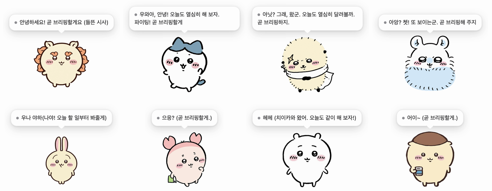
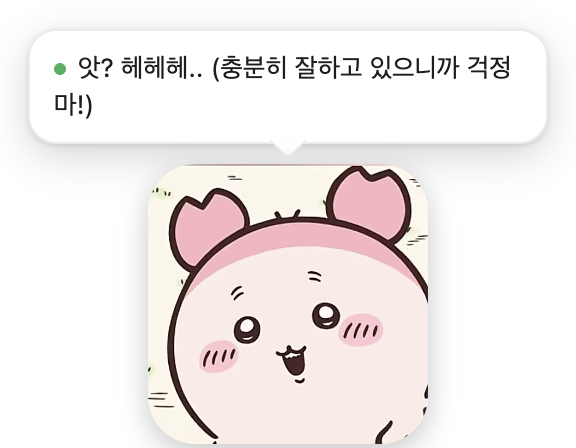
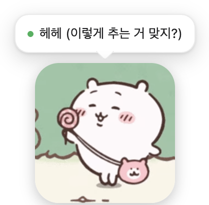
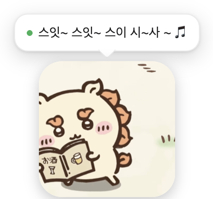
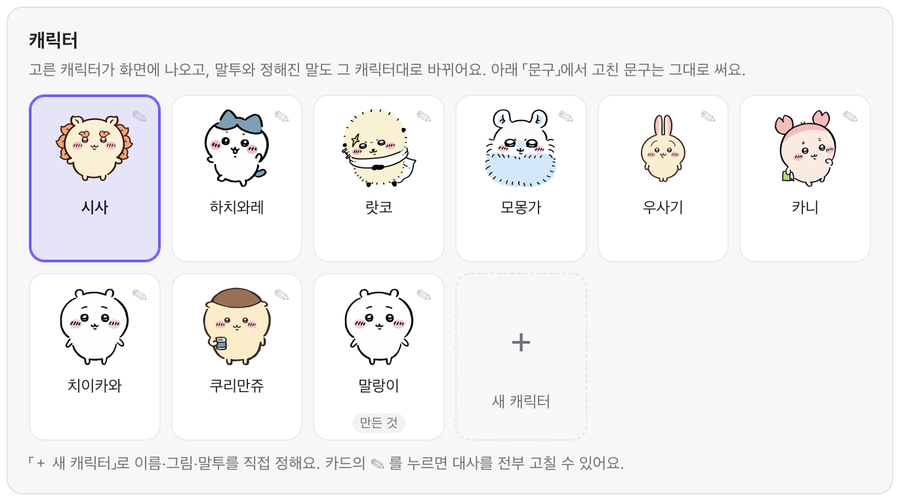
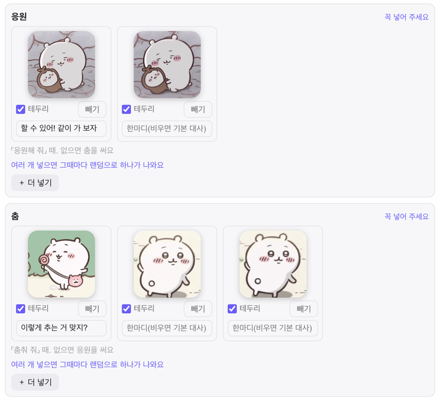
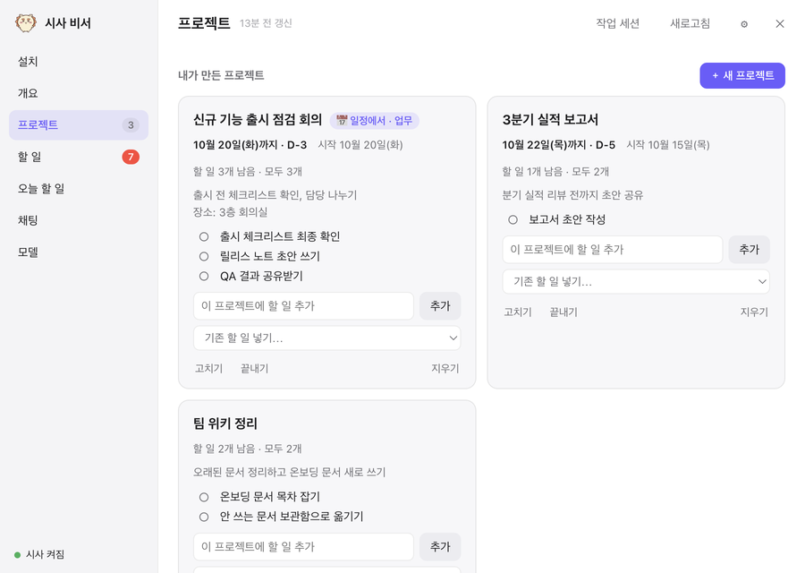
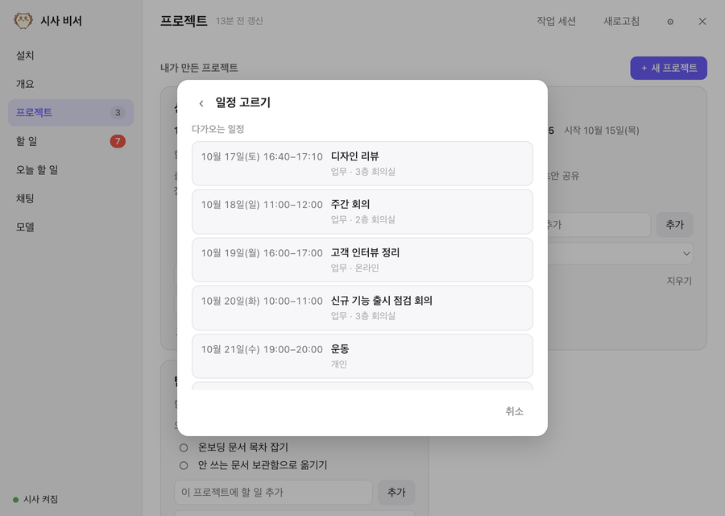
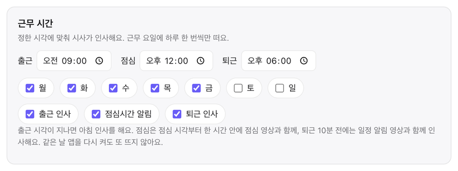

# 시사 비서 (shisa-agent)

화면 구석에 사는 작은 비서입니다. 캐릭터가 할 일이나 일정, 브리핑을 말풍선으로 알려 주고, 캐릭터를 누르면 할 일과 대화를 모아 둔 패널이 열립니다. 캐릭터는 기본 여덟 중에서 고르거나 직접 만들 수 있습니다.
데이터는 전부 내 컴퓨터(`~/.cy-agent/`)에만 저장됩니다. 따로 서버로 올라가는 건 없습니다.

macOS와 윈도우에서 쓸 수 있습니다. 윈도우 설치는 [windows/README.md](windows/README.md)를 봐 주세요.

v0.3.2: 패널에 캘린더 탭(주·월 보기, 캘린더마다 색·켜고 끄기)이 생기고, AI가 다음 주 같은 먼 일정도 직접 찾아 답합니다. 날씨 알리미(출근 후·퇴근 20분 전), 「오늘 꼭」이 곧 오늘 할 일, 말로 집중 시작하기, 프로젝트 안 할 일 이름·순서 바꾸기가 들어갔습니다.

v0.3.1: 메일을 연결할 수 있습니다. Gmail·네이버·다음 메일을 앱 비밀번호로 연결하면 답장이나 할 일이 필요한 메일을 골라 줍니다. 여러 계정을 넣을 수 있고, 메일은 읽기만 합니다. 채팅에서 모델을 고를 수도 있습니다.

v0.3.1 파일은 2026년 10월 18일 13시 15분(한국 시간)에 다시 올렸습니다. 업데이트 알림을 ✕ 로 닫을 수 있게 했고, 말풍선이 시간이 지나도 안 사라지던 것과 카니가 깜빡일 때 색과 몸 위치가 바뀌던 것을 고쳤습니다. 캐릭터를 다시 두 번 누르면 질문 칩이 닫힙니다. 그 전에 v0.3.1 을 받으셨다면 dmg 를 다시 받아 덮어써 주세요.

v0.3.0에서 바뀐 것:
- 카니·치이카와·쿠리만쥬가 들어와 기본 캐릭터가 여덟이 되었습니다. 캐릭터를 직접 만들 수도 있습니다([캐릭터](#캐릭터)).
- 한 동작에 영상을 여러 개 두고 그때마다 하나를 랜덤으로 틉니다. 영상마다 하는 말도 다릅니다.
- 근무 시간을 정하면 출근·점심·퇴근 10분 전에 캐릭터가 인사합니다([근무 시간](#근무-시간)).
- 프로젝트 탭에서 프로젝트를 직접 만들거나 캘린더 일정에서 가져와 할 일을 묶습니다([프로젝트](#프로젝트)).

써 보시고 불편한 점이 있으면 [의견 보내기](#의견-보내기)로 알려 주세요.

<p>
  
  
  
</p>

## 하는 일

- 캐릭터: 한 번 누르면 패널이 열리고, 두 번 누르면 그 자리에서 말을 걸 수 있습니다. AI를 연결하지 않았다면 두 번 눌렀을 때 「지금 할 일 뭐 있어요?」, 「응원해 줘」 같은 질문 칩이 뜨고, 고르면 바로 답합니다. 오른쪽 클릭으로 메뉴를 열고, 끌어서 아무 데나 옮겨 둘 수 있습니다.
- 할 일 정리: 연결해 둔 Slack·캘린더·메일·이슈와 내 Claude Code·Codex 작업 기록을 읽어서 챙길 일을 「오늘 꼭·이번 주·천천히·언젠가」로 나눠 모읍니다. 줄을 두 번 누르면 제목과 설명을 고칠 수 있고, ▶를 누르면 「(진행중)」이 붙습니다. 지운 할 일은 휴지통에 30일 동안 남습니다. "앞으로 세미나는 언젠가로"처럼 말해 두면 규칙으로 기억합니다.
- 오늘 할 일: 우선순위가 「오늘 꼭」인 할 일이 곧 오늘 할 일입니다. 할 일 탭에서 「오늘 꼭」으로 바꾸거나 줄의 「오늘」을 누르면 오늘 할 일 탭에 바로 보이고, 오늘 할 일 탭에서 「오늘」을 다시 누르면 「이번 주」로 내려갑니다. 오늘 할 일 탭에서 적은 일은 「오늘 꼭」으로 들어갑니다. 아침마다 적어 달라고 알려 주고(설정에서 N시간마다·정한 시각·끄기), 어제 못 끝낸 일이 남아 있으면 「어제 남은 N개, 오늘도 할까요?」라고 물어 그대로 둘지 이번 주로 내릴지 고르게 합니다. 절반이나 전부 끝내면 응원합니다.
- 프로젝트: 할 일을 프로젝트로 묶습니다. 직접 만들거나 캘린더 일정에서 가져올 수 있습니다. 아래 [프로젝트](#프로젝트)에 자세히 적었습니다.
- 캘린더: 캘린더 탭에서 연결한 캘린더 일정을 주·월·일 보기로 봅니다. 캘린더마다 색이 다르고, 위쪽 칩으로 캘린더를 보이거나 숨기고 색을 바꿀 수 있습니다. 일정을 누르면 회의 링크를 열거나 프로젝트·할 일로 만들 수 있고, 개요의 연결 카드에서 캘린더마다 켜고 끌 수 있습니다. AI에게 다음 주나 이번 달, 특정 날짜의 일정을 물어도 연결한 캘린더에서 그 기간을 읽어 답합니다.
- 진행 중 표시: ▶로 진행 중인 일은 캐릭터 머리 위에 「진행 중 · 할 일 제목」으로 떠 있습니다. 여러 개면 「제목 외 n개」로 보이고, 말풍선을 누르면 할 일 탭이 열립니다.
- 집중하기: 할 일 탭이나 오늘 할 일 탭에서 「▶ 집중하기」를 누르면 캐릭터도 공부를 시작하고, 머리 위 말풍선에 집중한 시간이 흘러갑니다. 쉰 시간은 빼고 셉니다. 목록 맨 아래 「오늘 집중」에서 주·월 기록을 GitHub 잔디처럼 봅니다. 캐릭터에게 「25분 집중할게」, 「보고서 할 일로 집중」, 「집중 그만」처럼 말해도 시작하고 멈춥니다. AI가 없으면 캐릭터를 두 번 눌러 「집중 시작할래?」 칩을 누르면 됩니다.
- 브리핑: 평일 9~19시(한국 시간)에는 한 시간마다 지금 챙길 일을 짧게 정리합니다. 메뉴의 「지금 브리핑」으로 아무 때나 부를 수도 있습니다.
- 일정 알림: 일정 10분 전(설정에서 5·15·30분 전이나 여러 번으로 바꾸거나 끌 수 있습니다)에 캐릭터가 영상과 함께 알립니다. 캘린더는 구글·Outlook ICS 주소를 여러 개 연결할 수 있습니다.
- 근무 시간: 출근 인사, 점심시간 알림, 퇴근 10분 전 인사를 합니다. 아래 [근무 시간](#근무-시간)에 적었습니다.
- 날씨: 고른 지역의 날씨를 출근 후 브리핑 다음과 퇴근 20분 전에 알려 줍니다. 아래 [날씨](#날씨)에 적었습니다.
- 채팅: 캐릭터를 두 번 눌러 말을 걸면 답이 머리 위 말풍선으로 뜹니다. 패널 채팅에서는 길게 대화하고 파일도 붙일 수 있습니다. 입력창으로 한 말은 늘 같은 대화방(「캐릭터 대화」)에 이어지고, 지난 대화는 목록에 남습니다.
- 패널 채팅 입력줄 옆 드롭다운에서 그 대화에 쓸 AI와 모델을 고를 수 있습니다. 키나 로그인이 된 다른 AI(Codex, Gemini 등)로도 그 대화만 보낼 수 있고, 고른 것은 대화마다 기억합니다. 답 아래에 어떤 모델이 답했는지 작게 나옵니다. 기본 AI 설정은 그대로입니다.
- 코드 작업: Claude Code 또는 Codex가 있으면 레포 코드를 고쳐 달라고 시킬 수 있습니다. 별도 워크트리에서 고치고 테스트를 돌린 다음, 통과하면 PR을 올리고 "머지할까요?" 하고 묻습니다. 어느 쪽으로 고칠지와 모델은 설정 창 「세부 모델」의 코드 작업 칸에서 고릅니다. Codex로 고칠 때는 그 워크트리 안에만 파일을 쓰고 네트워크는 쓰지 않습니다.

| 패널: 할 일 | 패널: 개요·브리핑 | 패널: 채팅 |
|---|---|---|
|  |  |  |

| 집중하기 | 오늘 집중: 월 기록 | 오늘 집중: 주 기록 |
|---|---|---|
|  |  |  |

| 작업 세션 창(코드 고치기) | 머지 승인 | 설정 창(⚙) |
|---|---|---|
|  |  |  |

## 캐릭터



윗줄부터 시사·하치와레·랏코·모몽가, 아랫줄 우사기·카니·치이카와·쿠리만쥬입니다. 설정 창 「캐릭터」에서 고르면 그림과 영상, 말투, 앱 이름(「하치와레 비서」처럼)이 바로 같이 바뀝니다.

| 캐릭터 | 말투 |
|---|---|
| 시사 | 다정한 존댓말 |
| 하치와레 | 밝은 반말 |
| 랏코 | 엄격한 말투 |
| 모몽가 | 살짝 시비 거는 말투 |
| 우사기 | `우나 야하(오늘 할 일이 3개 남았어.)`처럼 외침 뒤 괄호에 뜻을 담습니다 |
| 카니 | 말을 거의 못 해서 `헤헤헤... (오늘도 같이 힘내 보자!)`처럼 소리 뒤 괄호에 할 말을 적습니다 |
| 치이카와 | `헤헤 (오늘도 같이 해 보자!)`처럼 소리 뒤 괄호로 말합니다 |
| 쿠리만쥬 | 장면에 맞는 소리를 냅니다. 마실 때는 `캬아 (오늘도 고생 많았어!)`, 먹을 때는 `얌 얌 얌 (점심이다. 든든하게 먹고 하자.)` |

대사는 `assets/characters/lines.json` 한 파일에 모여 있습니다.

### 동작과 영상

캐릭터는 응원·춤·집중·일정 알림·점심시간마다 영상을 틉니다. 한 동작에 영상이 여러 개면 그때마다 하나를 랜덤으로 고르고(같은 영상이 연달아 나오지 않습니다), 영상마다 따로 하는 말이 있을 수 있습니다. 시사는 춤 영상이 둘이라 「お酒」 메뉴판 춤이 나오면 「스잇~ 스잇~ 스이 시~사 ~ 🎵」 하고 말하고, 치이카와는 일정 알림 영상 중 하나에서 울면서 알립니다. 기본 캐릭터의 동작별 영상 목록은 `assets/characters/clips.json`에 있습니다.

「응원해 줘」, 「춤춰 줘」는 캐릭터를 두 번 누르거나 입력창의 ＋를 누르면 뜨는 칩으로 언제든 부를 수 있습니다.

| 카니: 응원해 줘 | 쿠리만쥬: 응원해 줘 | 치이카와: 춤춰 줘 | 시사: 춤춰 줘 | 카니: 점심시간 |
|---|---|---|---|---|
|  |  |  |  |  |

| 하치와레: 응원해 줘 | 랏코: 응원해 줘 | 모몽가: 춤춰 줘 | 랏코: 춤춰 줘 |
|---|---|---|---|
|  |  |  |  |

| 우사기: 대기 | 우사기: 집중 | 우사기: 춤 | 우사기: 응원·알림 |
|---|---|---|---|
|  |  |  |  |

우사기 자산은 참고 자료를 바탕으로 제작한 생성 팬 아트이며 공식 영상·음원은 포함하지 않습니다. [그림·대사·출처](docs/usagi-character.md), [원본과 재생성 방법](artwork/usagi/README.md)을 참고하세요.

### 캐릭터 직접 만들기

설정 창 「캐릭터」의 「＋ 새 캐릭터」에서 만듭니다.

1. 이름을 적고, 말투를 가져올 캐릭터(기본 여덟이나 직접 만든 캐릭터)를 고릅니다.
2. 그림을 넣습니다. 눈 뜬 모습·눈 감은 모습·응원·춤은 꼭 넣고, 집중·일정 알림·점심시간은 골라서 넣습니다. png·jpg·webp·gif·webm·mp4를 받고, 움직이는 gif도 그대로 움직입니다.
3. 응원·춤·집중·일정 알림·점심시간 칸에는 파일을 여러 개 넣을 수 있습니다. 여러 개면 그때마다 하나가 랜덤으로 나옵니다.
4. 파일마다 둥근 테두리를 켜고 끄고, 「이 영상이 나올 때 할 한마디」를 적습니다. 비우면 기본 대사를 씁니다.

캐릭터 카드의 ✎를 누르면 그 캐릭터가 하는 말을 전부(말투, 고정 문구, 정해진 답, 설치 화면, 둘러보기 등) 고칠 수 있습니다. 기본 캐릭터도 고칠 수 있고, 고친 칸만 따로 저장되니 「기본값으로」를 누르면 처음으로 돌아갑니다. 만든 캐릭터는 이름과 그림도 바꾸거나 지울 수 있고, 쓰던 캐릭터를 지우면 시사로 돌아갑니다. 만든 캐릭터는 `~/.cy-agent/characters/`에 저장됩니다.

| 캐릭터 고르기 | 만든 캐릭터 고치기: 응원·춤에 파일 여러 개 |
|---|---|
|  |  |

## 프로젝트

패널의 프로젝트 탭에서 할 일을 프로젝트로 묶어 봅니다.

- 「＋ 새 프로젝트」에서 「새로 만들기」를 고르면 빈 칸에서 시작합니다. 「일정에서 가져오기」를 고르면 연결한 캘린더의 다가오는 일정 목록이 뜨고, 하나를 고르면 이름·메모(설명·장소·참석자)·날짜가 채워집니다. 일정에서 가져온 프로젝트에는 「📅 일정에서」 표시가 붙습니다.
- 카드에는 기한(D-n)과 남은 할 일 수가 보입니다. 카드에서 할 일을 바로 추가하거나, 「기존 할 일 넣기」로 이미 있는 할 일을 묶습니다.
- 채팅으로 「출시 준비 프로젝트 만들고 할 일 넣어 줘」처럼 말해도 됩니다.
- 코딩 작업에서 저절로 모은 프로젝트는 그 아래 「코드 작업에서 모은 것」에 따로 보입니다.

| 프로젝트 카드 | 일정에서 가져오기 |
|---|---|
|  |  |

## 근무 시간

설정 창 「근무 시간」에서 출근·점심·퇴근 시각(기본 09:00·12:00·18:00)과 근무 요일(기본 월~금)을 정합니다.

- 출근 인사: 출근 시각이 지나면 아침 인사를 합니다.
- 점심시간 알림: 점심 시각부터 한 시간 안에 점심 영상(먹는 장면)과 함께 인사합니다. 점심 영상이 없는 캐릭터는 일정 알림 영상이 나옵니다.
- 퇴근 인사: 퇴근 10분 전에 일정 알림 영상과 함께 「곧 퇴근이야! 오늘도 고생했어, 안녕~」 같은 인사를 합니다.

셋 다 근무 요일에 하루 한 번씩이고, 하나씩 끌 수 있습니다. 채팅에서 「퇴근까지 얼마나 남았어?」처럼 물어도 답합니다.



## 날씨

설정 창 「날씨」에서 지역을 고르면 캐릭터가 그 지역 날씨를 알려 줍니다. AI 없이 정해진 말로 알립니다. 지역을 고르기 전에는 꺼져 있고, 바깥에 아무것도 묻지 않습니다.

- 지역 고르기: 칸에 「서울」, 「성남시」처럼 지역 이름을 치면 아래에 「성남시 · 경기도 · 대한민국」 같은 후보가 뜹니다. ↑↓와 Enter, 또는 클릭으로 고릅니다. 동네·구 이름으로 안 나오면 시 이름으로 찾아 주세요. 고른 뒤에는 [바꾸기]·[지우기]가 보이고, 지우면 날씨 알림이 꺼집니다.
- 알리는 때: 기본은 두 번입니다. 출근 인사와 아침 브리핑이 끝난 다음(브리핑이 없으면 출근 인사 1~2분 뒤)에 오늘 날씨를, 퇴근 20분 전에 퇴근 시간대(퇴근 2시간 전부터 3시간 뒤까지) 날씨를 알립니다. 퇴근길에 비나 눈이 오면 「퇴근길 비 와요, 우산!」처럼 먼저 말합니다. 퇴근 10분 전 인사와는 따로입니다.
- 정한 시각: 「정한 시각에도」에 시각을 넣으면 그때도 알립니다. 두 기본 알림도 하나씩 끌 수 있습니다.
- 모두 근무 요일에 하루 한 번씩이고, 같은 날 앱을 다시 켜도 또 뜨지 않습니다.
- 언제든 캐릭터를 두 번 누르거나 입력창 ＋ 에서 「오늘 날씨?」 칩을 누르면 지금 날씨를 알려 줍니다.
- AI를 연결해 두었다면 채팅과 브리핑에도 오늘 날씨 한 줄이 같이 들어갑니다.

날씨는 [Open-Meteo](https://open-meteo.com/)에서 가져옵니다. 키나 가입 없이 비상업 용도로 무료로 쓸 수 있는 서비스이고, 데이터는 [CC BY 4.0](https://creativecommons.org/licenses/by/4.0/)입니다. Open-Meteo로 보내는 것은 지역을 찾을 때 친 글자와, 고른 지역의 위도·경도·시간대뿐입니다. 이 맥의 위치(GPS)는 쓰지 않습니다. 예보는 45분 동안 저장해 두고 다시 쓰며, 못 가져오면 조용히 넘어가고 설정 창 「연결 상태」의 날씨 줄에 이유를 보여 줍니다.

## 뭘 연결하면 뭐가 되나

AI는 선택입니다. AI 없이도 할 일, 오늘 할 일, 프로젝트, 집중하기, 일정 알림, 근무 시간 인사, 응원과 춤 같은 기본 기능은 그대로 쓸 수 있습니다. 캐릭터와 자유롭게 대화하거나 브리핑 요약을 받고 싶을 때만 AI를 하나 연결하면 됩니다. 여기서는 이 AI를 "뇌"라고 부릅니다.

| 기능 | 뇌 없음 | Gemini·OpenAI·Claude API·Genspark 키 | Codex | Claude Code |
|---|:-:|:-:|:-:|:-:|
| 캐릭터·패널, 할 일 보기·고치기, 오늘 할 일, 직접 만든 프로젝트, 집중하기 | ✓ | ✓ | ✓ | ✓ |
| 캐릭터 고르기·만들기, 대사 고치기 | ✓ | ✓ | ✓ | ✓ |
| 더블클릭 질문 칩, 응원·춤, 채팅에서 고르는 말 | ✓ | ✓ | ✓ | ✓ |
| 정해진 말(인사·할 일 일깨우기·칭찬), 근무 시간 인사·점심시간 알림, 날씨 알림 | ✓ | ✓ | ✓ | ✓ |
| 일정 알림(기본 10분 전, 캘린더 ICS 주소 여러 개) | ✓ | ✓ | ✓ | ✓ |
| 더블클릭으로 말 걸기, 패널 채팅 | | ✓ | ✓ | ✓ |
| 브리핑 요약, 브리핑이 할 일 새로 정리 | | ✓ | ✓ | ✓ |
| 끝난 할 일 자동 완료·(진행중) 자동 표시, 지식그래프·나에 대해 배우기 | | | ✓ | ✓ |
| mcp 모드 연결(메일·이슈 등 MCP 서버 읽기) | | | | ✓ |
| 코드 고치기·워크트리·백그라운드 에이전트, 작업 세션 「새 작업」·「이어서 하기」, 자동 머지, 레포 폴더 | | | | ✓ |

AI 없이 쓰는 중에 캐릭터를 두 번 누르면 「오늘 할 일 얼마나 했어요?」, 「다음 일정은요?」 같은 질문 칩이 뜹니다. 하나를 누르면 AI 없이 바로 답하고, 2초 뒤에 칩이 다시 뜹니다. 「응원해 줘」, 「춤춰 줘」를 누르면 그 캐릭터 영상이 나옵니다.
뇌는 패널 [모델] 탭이나 설치 마법사에서 언제든 바꿀 수 있고, 앱을 다시 켜지 않아도 바로 적용됩니다. 뇌별 차이는 [docs/connect/brain.md](docs/connect/brain.md)에 정리해 두었습니다.

## 설치

설치 방법은 두 가지입니다. 개발을 모른다면 「쉬운 설치(앱)」를 쓰면 됩니다. 터미널이나 Homebrew는 필요 없습니다.

### 쉬운 설치(앱)

#### 1. 내 맥에 맞는 파일 받기

[Releases 페이지](https://github.com/cheo0y/shisa-agent/releases/latest)에서 내 맥에 맞는 dmg 파일을 받습니다.

| 내 맥 | 받을 파일 |
|---|---|
| 애플 실리콘(M1, M2, M3, M4 등) | `Shisa-<버전>-arm64.dmg` |
| 인텔 | `Shisa-<버전>-x64.dmg` |

어느 쪽인지 모르겠다면 화면 왼쪽 위 사과 메뉴에서 「이 Mac에 관하여」를 엽니다. 「칩」 칸에 Apple M으로 시작하는 이름이 보이면 애플 실리콘이고, 「프로세서」 칸에 Intel이 보이면 인텔입니다.

#### 2. 응용 프로그램 폴더로 끌어다 놓기

받은 dmg 파일을 더블클릭하면 창이 하나 열립니다. 창 안의 「시사」를 옆의 「응용 프로그램」 폴더 위로 끌어다 놓으면 설치가 끝납니다. 다 옮겨졌으면 Finder 왼쪽 목록에서 「시사」 디스크 옆의 꺼내기 버튼을 눌러 dmg를 닫아도 됩니다.

#### 3. 처음 열기

응용 프로그램 폴더(또는 Launchpad)에서 시사를 엽니다.

시사는 애플의 개발자 확인(공증)을 받지 않은 앱이라, 처음 열 때 「"시사"을(를) 열 수 없습니다」 또는 「Apple은 "시사"에 악성 코드가 없음을 확인할 수 없습니다」라는 창이 뜹니다. 이때는 「완료」를 눌러 창을 닫고 아래 순서대로 한 번만 허용해 주면 됩니다.

1. 사과 메뉴에서 「시스템 설정」을 엽니다.
2. 왼쪽 목록에서 「개인정보 보호 및 보안」을 누릅니다.
3. 오른쪽을 맨 아래 「보안」 부분까지 내리면 「"시사"이(가) 확인된 개발자가 아니기 때문에 사용이 차단되었습니다」라는 문구와 「그래도 열기」 버튼이 보입니다. 「그래도 열기」를 누릅니다.
4. 맥 로그인 암호(또는 Touch ID)를 입력합니다.
5. 다시 뜨는 창에서 「그래도 열기」를 누릅니다.

이 문구와 버튼은 시사를 열어 보려고 한 뒤 한 시간쯤 동안만 보입니다. 보이지 않으면 시사를 한 번 더 열어 본 뒤 2번부터 다시 해 주세요. 한 번 허용하면 다음부터는 바로 열립니다.

#### 4. 설치 마법사

시사가 처음 뜨면 캐릭터가 화면 오른쪽 아래에 나타나고 설치 마법사가 열립니다. 순서는 아래 [설치 마법사](#설치-마법사)에 적어 두었습니다.

마법사를 마치면 맥에 로그인할 때 시사가 알아서 켜집니다. 원하지 않으면 설정(⚙)의 「이 앱」에서 「로그인할 때 시사 켜기」를 끄면 됩니다.

#### 뇌(AI) 준비 (선택)

이 단계는 건너뛰어도 됩니다. 뇌(AI)가 없어도 할 일 보기·고치기, 오늘 할 일 표, 일정 알림(캘린더 ICS 주소), 인사나 할 일 일깨우기 같은 정해진 말은 그대로 동작합니다.

말을 걸고 대화하거나 브리핑 요약도 받고 싶다면 AI를 하나 연결합니다. 앱에는 시사만 들어 있고 Claude Code나 Codex는 들어 있지 않으니, 이 둘을 뇌로 쓰려면 따로 설치해야 합니다.

- Claude Code: 모든 기능을 쓸 수 있어서 추천합니다. 터미널에서 `curl -fsSL https://claude.ai/install.sh | bash`를 실행하고, `claude`를 쳐서 브라우저로 로그인한 뒤 `/exit`로 나오면 끝입니다.
- Codex: [Codex CLI 설치 안내](https://developers.openai.com/codex)대로 설치하고 로그인하세요.
- API 키: Gemini·OpenAI·Claude API 키가 있다면 설치 마법사에 붙여 넣기만 하면 됩니다. 따로 설치할 건 없습니다.
- Genspark: 유료 플랜이 있다면 `gsk login` 한 키를 고르거나 키를 붙여 넣으면 됩니다. 자세한 건 [brain.md](docs/connect/brain.md#genspark)에 있습니다.

#### 업데이트

새 버전이 나오면 캐릭터가 「새 버전 v0.3.1 가 나왔어요」처럼 알려 줍니다. 「받으러 가기」를 누르면 Releases 페이지가 열립니다. 하루에 한 번 확인하고, 설정의 「이 앱」에서 끌 수 있습니다.

업데이트하는 방법은 처음 설치할 때와 같습니다.

1. 메뉴 막대의 시사 아이콘에서 「종료」를 눌러 시사를 끕니다.
2. 새 dmg를 받아 열고, 시사를 응용 프로그램 폴더로 끌어다 놓습니다.
3. 「대치」를 누릅니다.

할 일, 대화, 설정 같은 데이터는 앱이 아니라 `~/.cy-agent/` 폴더에 있어서 그대로 남습니다. 새 버전을 처음 열 때 다시 「그래도 열기」를 해야 할 수 있습니다.

#### 지우기

1. 설정의 「이 앱」에서 「로그인할 때 시사 켜기」를 끄고, 메뉴 막대의 시사 아이콘에서 「종료」를 누릅니다.
2. 응용 프로그램 폴더의 시사를 휴지통으로 옮깁니다.
3. 데이터까지 지우려면 Finder에서 `⌘ Command` + `Shift` + `G`를 누르고 아래 두 폴더를 하나씩 열어 휴지통으로 옮깁니다.
   - `~/.cy-agent` (할 일, 대화, 설정, 기록)
   - `~/Library/Application Support/cy-agent-desktop` (창 위치 같은 앱 설정)

### 설치 마법사

시사가 처음 뜨면 패널의 「설치」 탭이 열립니다. 어느 단계든 건너뛰어도 괜찮습니다.

1. 이름: 뭐라고 부를지 정합니다.
2. 뇌 고르기(선택): 이 맥에 로그인된 Claude Code나 Codex가 있으면 「찾았어요 ✓」로 떠서 바로 고를 수 있습니다. Gemini·OpenAI·Claude API 키를 붙여 넣어도 됩니다. AI 없이 쓰려면 「AI 없이 쓰기」를 고르세요. 할 일, 오늘 할 일 표, 캘린더(ICS) 회의 알림, 인사와 응원은 그대로 되고, 마법사도 다음 단계로 그대로 이어집니다. AI는 나중에 설정에서 언제든 연결할 수 있습니다.
3. 더 연결하기: 구글·Outlook 캘린더 ICS 주소, Slack, 레포 폴더를 연결합니다. 캘린더는 「＋ 캘린더 추가」로 별칭(회사·개인 등)과 주소를 짝지어 여러 개 넣을 수 있고, 줄마다 켜고 끄거나 별칭을 고치거나 뺄 수 있습니다.
4. 끝: 「사용법 둘러보기」를 누르면 캐릭터가 다섯 장면으로 하나씩 보여 줍니다.

| 뇌 고르기 | 더 연결하기 | 사용법 둘러보기 |
|---|---|---|
|  |  |  |

마법사는 설정(⚙)의 「설치 다시 하기」로 다시 열 수 있습니다. 사용법 둘러보기는 메뉴바 아이콘, 캐릭터 메뉴, 설정의 「사용법 다시 보기」에서 다시 볼 수 있습니다.

이름·뇌·레포 폴더는 바로 적용됩니다. 캘린더와 Slack을 연결하면 시사가 데몬을 잠깐 껐다 켜서 적용합니다. 그래도 반영되지 않으면 메뉴 막대의 시사 아이콘에서 「종료」를 누르고 시사를 다시 열어 주세요. 터미널로 설치했다면 아래 한 줄로 데몬만 다시 켤 수도 있습니다.

```bash
launchctl kickstart -k gui/$(id -u)/com.cy-agent.daemon
```

### 터미널로 설치(개발자용)

코드를 직접 고쳐 쓰거나 최신 코드를 바로 받고 싶을 때 쓰는 방법입니다. Homebrew, Node.js, git으로 레포를 받아 `ops/install.sh`로 설치합니다. 데몬과 앱은 launchd에 등록되어 로그인할 때 켜지고, 앱은 `~/Applications/cy.app`에 들어갑니다. 앱(dmg)으로 설치한 시사와 함께 쓰지 말고 하나만 골라 주세요.

아래 회색 상자에 있는 글을 그대로 복사해서 터미널에 붙여 넣고 Enter만 누르면 됩니다.

##### 0. 터미널 열기

`⌘ Command` + `Space`를 누르고 "터미널"이라고 친 다음 Enter를 누릅니다. 검은(또는 흰) 창이 뜨면 준비는 끝났습니다.
중간에 비밀번호를 물으면 맥 로그인 비밀번호를 입력하면 됩니다. 쳐도 화면에 아무것도 안 보이는 게 정상이니, 그냥 끝까지 치고 Enter를 누르세요.

##### 1. Homebrew 설치

맥에 프로그램을 쉽게 깔 수 있게 해 주는 도구입니다.

```bash
/bin/bash -c "$(curl -fsSL https://raw.githubusercontent.com/Homebrew/install/HEAD/install.sh)"
```

- 「Command Line Tools를 설치할까요?」 창이 뜨면 설치를 눌러 주세요. 몇 분 걸립니다.
- 다 끝나면 터미널 마지막의 Next steps 아래에 `echo ... >> ~/.zprofile`, `eval ...` 두 줄이 나옵니다. 이 두 줄도 복사해서 붙여 넣고 Enter를 누르세요.
- `brew --version`을 쳤을 때 버전 숫자가 나오면 성공입니다.

##### 2. Node.js와 git 설치

```bash
brew install node git
```

`node -v`를 쳐서 `v24` 이상이 나오고, `git --version`을 쳐서 버전 숫자가 나오면 됩니다.

git은 코드를 내려받는 프로그램입니다. 1단계에서 Homebrew를 깔 때 함께 설치되는 Command Line Tools에도 들어 있어서, 위 명령을 실행했다면 따로 할 일은 없습니다. Homebrew 없이 git만 설치하고 싶다면 아래 방법 중 하나를 쓰면 됩니다.

- 터미널에 `xcode-select --install`을 입력하고, 뜨는 창에서 설치를 누릅니다. 애플이 제공하는 기본 도구라 가장 간단합니다.
- [git 공식 다운로드 페이지](https://git-scm.com/download/mac)에서 맥용 설치 방법을 따라 합니다.

##### 3. 시사 받기

```bash
git clone https://github.com/cheo0y/shisa-agent.git ~/shisa-agent
```

공개 레포라서 GitHub 계정이나 로그인 없이 바로 받아집니다. 계정은 Fork를 하거나 Issue, PR을 올릴 때만 필요합니다. 개발자라면 Fork해서 내 계정으로 받아 두고 마음대로 고쳐 쓰셔도 됩니다.

git이 없다면 [레포 페이지](https://github.com/cheo0y/shisa-agent)에서 초록색 Code 버튼 → Download ZIP으로 받아도 됩니다. 압축을 풀고 폴더 이름을 `shisa-agent`로 바꾼 뒤 홈 폴더로 옮겨 두면 다음 단계는 똑같습니다. 다만 이 방법으로 받으면 새 버전도 ZIP을 다시 받아 설치해야 합니다.

##### 4. 설치 실행

```bash
cd ~/shisa-agent && ./ops/install.sh
```

몇 분 걸리고, 끝나면 화면 오른쪽 아래에 시사가 나타납니다.
앱은 `응용 프로그램` 폴더가 아니라 홈 폴더의 `~/Applications/cy.app`에 설치되고, 맥에 로그인할 때마다 알아서 켜집니다.

##### 5. 뇌 준비 (선택)

이 단계는 건너뛰어도 됩니다. 뇌(AI)가 없어도 할 일 보기·고치기, 오늘 할 일 표, 일정 알림(캘린더 ICS 주소), 인사나 할 일 일깨우기 같은 정해진 말은 그대로 동작합니다. 알림 비서로만 쓰실 거라면 이걸로 충분합니다.

말을 걸고 대화하거나 브리핑 요약도 받고 싶다면 AI를 하나 연결하면 됩니다. 아래 셋 중 편한 걸 고르면 됩니다.

- Claude Code: 모든 기능을 쓸 수 있어서 추천합니다. 터미널에서 `curl -fsSL https://claude.ai/install.sh | bash`를 실행하고, `claude`를 쳐서 브라우저로 로그인한 뒤 `/exit`로 나오면 끝입니다.
- Codex: [Codex CLI 설치 안내](https://developers.openai.com/codex)대로 설치하고 로그인하세요.
- API 키: Gemini·OpenAI·Claude API 키가 있다면 설치 마법사에 붙여 넣기만 하면 됩니다. 따로 설치할 건 없습니다.
- Genspark: 유료 플랜이 있다면 `gsk login` 한 키를 고르거나 키를 붙여 넣으면 됩니다. 자세한 건 [brain.md](docs/connect/brain.md#genspark)에 있습니다.

##### 6. 설치 마법사

시사가 처음 뜨면 마법사가 열립니다. 순서는 위 [설치 마법사](#설치-마법사)에 적어 두었습니다.

#### 터미널 설치의 업데이트와 삭제

새 버전 받기: 터미널에 아래 한 줄을 붙여 넣으면 GitHub에서 최신 버전을 받고, 설치해서 적용한 뒤, 시사를 다시 띄웁니다.

```bash
cd ~/shisa-agent && ./ops/update.sh
```

`ops/update.sh`가 아직 없는 예전 버전이라면 이 한 줄을 대신 씁니다. 하는 일은 같습니다.

```bash
curl -fsSL https://raw.githubusercontent.com/cheo0y/shisa-agent/main/ops/update.sh | sh
```

이 한 줄은 `~/shisa-agent` 폴더가 없으면 처음부터 받아서 설치까지 하므로, 새로 설치할 때 3·4단계 대신 써도 됩니다.

받은 뒤에는 바뀐 내용 목록이 나오고, 캐릭터가 잠깐 사라졌다가 다시 나타나면 끝입니다. 설정과 할 일 같은 데이터(`~/.cy-agent/`)는 그대로 남습니다.
레포 폴더 안의 파일을 직접 고쳐 두었다면 덮어쓰지 않고 멈추니, 안내대로 정리한 뒤 다시 실행해 주세요.
Fork해서 쓰고 있다면 GitHub에서 「Sync fork」를 먼저 눌러 주세요.

지우기:

```bash
cd ~/shisa-agent && ./ops/uninstall.sh
```

이 명령은 로그인 시 자동 실행 등록만 풉니다. 앱(`~/Applications/cy.app`)과 데이터 폴더(`~/.cy-agent/`)는 그대로 남으니, 완전히 지우려면 이 두 개도 직접 지워 주세요.

### 안 될 때

| 증상 | 해결 |
|---|---|
| 앱: 「"시사"을(를) 열 수 없습니다」, 「악성 코드가 없음을 확인할 수 없습니다」 | [3. 처음 열기](#3-처음-열기)의 「그래도 열기」 순서대로 한 번 허용해 주세요 |
| 앱: 「"시사"이(가) 손상되었기 때문에 열 수 없습니다」 | 내 맥에 맞지 않는 파일(애플 실리콘/인텔)을 받았거나 받다가 끊겼을 수 있습니다. 맞는 dmg를 다시 받아 덮어써 주세요 |
| 앱: 캐릭터가 안 보임 | 응용 프로그램 폴더에서 시사를 다시 열어 주세요. 메뉴 막대에 시사 아이콘이 있으면 이미 켜져 있는 것이니, 아이콘을 눌러 「패널 열기」를 해 보세요 |
| 앱: 패널에 「시사 꺼짐」이 계속 보임 | 시사를 종료했다가 다시 열어 주세요. 그래도 같으면 아래 「그래도 안 됨」 |
| 앱: 다른 앱이나 다른 데스크톱에서 돌아와도 패널이 안 열림 | 닫은 패널은 저절로 다시 열리지 않습니다. 캐릭터를 누르거나 Dock 아이콘, 메뉴 막대 아이콘의 「패널 열기」로 열어 주세요(Windows는 작업 표시줄 알림 영역의 시사 아이콘) |
| 터미널: `command not found: brew` | 1번 끝에 나온 Next steps 두 줄을 실행했는지 확인하고, 터미널을 껐다 다시 열어 보세요 |
| 터미널: `command not found: git` | 터미널에 `xcode-select --install`을 입력해 설치하거나, Download ZIP으로 받아 주세요(3단계) |
| 터미널: `node -v`가 24보다 낮게 나옴 | `brew upgrade node` |
| 터미널: `./ops/install.sh`가 「Node.js 가 없습니다」나 「너무 낮습니다」라며 멈춤 | 2단계로 돌아가 `brew install node` 또는 `brew upgrade node` |
| 터미널: `permission denied: ./ops/install.sh` | `sh ops/install.sh`로 실행해 주세요(ZIP으로 받으면 실행 권한이 빠질 수 있습니다) |
| 터미널: `./ops/update.sh`가 「최신 버전을 받지 못했습니다」라며 멈춤 | 인터넷 연결을 확인하고, 레포 폴더에 직접 만든 커밋이나 파일이 있으면 정리한 뒤 다시 실행해 주세요 |
| 터미널: 캐릭터가 안 보임 | `open ~/Applications/cy.app` |
| 그래도 안 됨 | 캐릭터에서 `⌘ Command` + `Shift` + `D`를 누르면 「도움 보내기」 창이 기록을 모아 줍니다. 터미널을 쓸 수 있다면 `tail -50 ~/.cy-agent/logs/*.log` 결과도 좋습니다. [의견 보내기](#의견-보내기)로 보내 주세요 |

## 연결

기능마다 어디서 읽어 올지는 `~/.cy-agent/config.json`의 `connectors`에서 정합니다. 모드는 네 가지입니다.

- `api`: 시사가 직접 읽습니다. 모델 비용이 들지 않고, 어떤 뇌를 쓰든 동작합니다.
- `imap`: 메일만 씁니다. 메일 주소와 앱 비밀번호로 시사가 받은편지함을 직접 읽습니다(읽기 전용). 어떤 뇌를 쓰든 동작합니다.
- `mcp`: Claude Code에 등록해 둔 MCP 서버로 읽습니다. 지금은 뇌가 Claude Code일 때만 됩니다.
- `off`: 쓰지 않습니다.

| 기능 | 추천 | 다른 방법 | 안내 |
|---|---|---|---|
| 캘린더(회의 알림·일정) | `api`: 비공개 ICS 주소 | `mcp`(Google Calendar·Microsoft 365) | [calendar.md](docs/connect/calendar.md) |
| Slack(DM·멘션 → 할 일) | `api`: 내 Slack 앱의 읽기 전용 사용자 토큰 | `mcp` | [slack.md](docs/connect/slack.md) |
| 메일(답장·조치 필요한 메일 → 할 일) | `imap`: 메일 주소 + 앱 비밀번호(Gmail·네이버·다음, 그 밖의 IMAP, 계정 여러 개) | `mcp`(Gmail·Microsoft 365) | [mail.md](docs/connect/mail.md) |
| 이슈 | `mcp`(GitHub·Jira·Linear) |  | [issues.md](docs/connect/issues.md) |
| 뇌 | 설치 마법사에서 고르기 | `brain.provider` | [brain.md](docs/connect/brain.md) |
| Claude Code |  |  | [claude-code.md](docs/connect/claude-code.md) |
| 그 밖의 읽기용 MCP(노션 등) |  |  | [more-mcp.md](docs/connect/more-mcp.md) |

무엇을 연결하든 읽기만 합니다. 메일 보내기, Slack에 글쓰기, 일정 바꾸기 같은 쓰기 도구는 막아 두었습니다. 지금 무엇이 연결돼 있는지는 패널 「개요」의 연결 카드나 설정 창의 「연결 상태」에서 확인할 수 있습니다. 캘린더 줄에는 가져온 일정 수나, 못 가져왔다면 그 이유가 보입니다. 메일 줄도 같습니다.

설정은 대략 이런 모양입니다.

```json
{
  "connectors": {
    "calendar": { "mode": "api", "calendars": [{ "name": "회사", "url": "https://calendar.google.com/calendar/ical/.../basic.ics" }], "email": "me@example.com" },
    "slack": { "mode": "api", "userToken": "xoxp-..." },
    "mail": { "mode": "imap", "accounts": [{ "preset": "gmail", "user": "me@gmail.com", "password": "YOUR_APP_PASSWORD" }] },
    "issues": { "mode": "mcp", "preset": "github" }
  },
  "repoRoots": ["/Users/YOUR_NAME/code"]
}
```

전체 예시는 [`ops/config.example.json`](ops/config.example.json)에 있습니다.

## 설정 파일 (`~/.cy-agent/config.json`)

같은 값이 여러 군데 있으면 환경변수 → `config.json` → 기본값 순으로 씁니다. 설정 창(⚙)이나 설치 마법사에서 바꾼 값도 이 파일에 저장됩니다.

| 키 | 환경변수 | 기본값 | 설명 |
|---|---|---|---|
| `onboarded` |  | 새 설치는 `false` | 설치 마법사를 마쳤는지. `false`인 동안은 브리핑·정리 작업(모델)을 하나도 돌리지 않고, 작업 기록과 레포도 읽지 않습니다. 마법사의 「다 했어요」나 「설치는 나중에 할게요」를 누르면 `true`가 됩니다. 이 키가 없는 예전 설정은 마친 것으로 봅니다 |
| `readSessions` |  | 새 설치는 `false` | 이 맥의 Claude Code·Codex 작업 기록(`~/.claude/projects`, `~/.codex/sessions`)을 읽을지. 마법사의 「더 연결하기」나 설정 창 「이 맥에서 읽는 것」에서 켜고 끕니다. 예전 설정은 `true` |
| `brain.provider` | `CY_AGENT_BRAIN` | 새 설치는 `local`(아직 안 고름), 예전 설정은 `claude-code` | 뇌. `claude-code` · `codex` · `gemini` · `openai` · `anthropic`(Claude API 키) · `genspark` · `local`(뇌 없음) |
| `brain.geminiApiKey` | `CY_AGENT_GEMINI_API_KEY` / `GEMINI_API_KEY` |  | Gemini 키 |
| `brain.openaiApiKey` | `CY_AGENT_OPENAI_API_KEY` / `OPENAI_API_KEY` |  | OpenAI 키 |
| `brain.anthropicApiKey` | `CY_AGENT_ANTHROPIC_API_KEY` |  | Claude API 키. `ANTHROPIC_API_KEY`는 Claude Code도 쓰는 이름이라 일부러 읽지 않습니다 |
| `brain.gensparkApiKey` | `CY_AGENT_GENSPARK_API_KEY` |  | Genspark 키. 비워 두면 `gsk login`이 남긴 키(`~/.genspark-tool-cli/config.json`)를 쓸 때마다 읽습니다. 유료 플랜이 있어야 대답합니다 |
| `user.name` / `user.aliases` | `CY_AGENT_USER_NAME` | git `user.name` | 부를 이름 / 지식그래프에서 "나"로 볼 다른 이름들. 비워 두면 git 이름을 부르고, git 이름·이메일 아이디·맥 계정 이름도 "나"로 봅니다 |
| `repoRoots` |  | 새 설치는 `[]`, 예전 설정은 `["~/code"]` | 코드를 고쳐도 되는 레포 폴더. 개요의 내 커밋도 이 폴더에서만 읽습니다. 이 밖은 건드리지 않습니다 |
| `allowMcp` |  | `[]` | 커넥터 밖에서 채팅이 더 써도 되는 MCP 서버 이름(예: `["notion"]`). 여기 없는 서버는 Claude Code에 등록돼 있어도 브리핑·채팅에서 쓰지 않습니다 |
| `connectors.<기능>` | `CY_AGENT_SLACK_USER_TOKEN`, `CY_AGENT_CALENDAR_ICS_URL`, `CY_AGENT_MAIL_PASSWORD` | 전부 off | 위 [연결](#연결) 참고 |
| `slackBotToken` / `slackAppToken` / `slackUserId` | `SLACK_BOT_TOKEN` / `SLACK_APP_TOKEN` / `SLACK_USER_ID` |  | (선택) Slack 봇 DM·할 일 캔버스. [slack.md](docs/connect/slack.md) |
| `models.quick` / `.general` / `.code` / `.light` | `CY_AGENT_MODEL_QUICK` / `_GENERAL` / `_CODE` / `_LIGHT` | Sonnet / Sonnet / Opus / Haiku | 더블클릭 대화 / 브리핑·채팅 / 코드 고치기 / 가벼운 일 (Claude Code일 때) |
| `brainModels.<뇌>.quick` / `.general` / `.light` |  | 그 AI 기본 | Codex·Gemini·OpenAI·Genspark일 때 쓸 모델. 설정 창 「세부 모델」에서 지금 AI 칸만 바뀌고 다른 AI 값은 그대로입니다 |
| `autoMerge` |  | `[]` | 묻지 않고 머지까지 할 레포(`owner/name`). 설정 창이나 채팅으로 바꿀 수 있습니다 |
| `briefing.exclude` |  | `[]` | 브리핑에서 뺄 출처(`mail`·`calendar`·`slack`·`issues`·`sessions`) |
| `calendarAlert.minutesBefore` |  | `[10]` | 일정 몇 분 전에 알릴지(양의 정수 분, 몇 개든, 예: `[15, 5]`, 하루 전은 `[1440]`). `[]`이면 알림을 끕니다. 설정 창 「일정 알림」에서 고칩니다 |
| `character` |  | `shisa` | 고른 캐릭터. `shisa`·`hachi`·`rakko`·`momonga`·`usagi`·`kani`·`chiikawa`·`kuri` 또는 직접 만든 캐릭터 id(`u-…`) |
| `workStart` / `lunchTime` / `workEnd` |  | `"09:00"` / `"12:00"` / `"18:00"` | 출근·점심·퇴근 시각(24시간 `HH:MM`). 설정 창 「근무 시간」에서 고칩니다 |
| `workDays` |  | `[1,2,3,4,5]` | 근무 요일(0 일요일 ~ 6 토요일) |
| `startAlert` / `lunchAlert` / `leaveAlert` |  | `true` | 출근 인사 / 점심시간 알림 / 퇴근 10분 전 인사 켜고 끄기 |
| `weather.place` |  | 없음 | 날씨 지역(`name`·`label`·`latitude`·`longitude`·`timezone`). 없으면 날씨가 꺼져 있습니다. 설정 창 「날씨」에서 고릅니다 |
| `weather.morning` / `.leave` / `.times` |  | `true` / `true` / `[]` | 출근 후 브리핑 다음 / 퇴근 20분 전 날씨 켜고 끄기 / 그 밖에 알릴 시각(`HH:MM`) |
| `phrases` |  | 기본 문구 | 캐릭터가 하는 정해진 말. 설정 창 「문구」에서 고칩니다 |
| `gitAuthor.name` / `.email` | `CY_AGENT_GIT_NAME` / `CY_AGENT_GIT_EMAIL` | `git config --global` | "내 커밋" 판정과 자동 수정 커밋의 작성자 |
| `briefingIntervalMin` · `ingestIntervalMin` · `slackIngestIntervalMin` |  | 60 · 10 · 5 | 주기(분) |
| `port` | `CY_AGENT_PORT` | `47823` | 데몬과 앱이 주고받는 로컬 포트 |
|  | `CY_AGENT_HOME` | `~/.cy-agent` | 데이터 폴더 |

뇌, 이름, 레포 폴더, 모델, 브리핑 출처, 오늘 할 일 알림, 일정 알림, 근무 시간, 날씨, 캐릭터, 문구, 자동 머지는 설정 창이나 마법사에서 바꾸면 바로 적용됩니다. 그 밖의 키를 파일에서 직접 고쳤다면 `launchctl kickstart -k gui/$(id -u)/com.cy-agent.daemon`으로 데몬을 다시 켜 주세요.

## 개인정보와 안전

수집한 메시지, 세션 기록, 지식그래프, 토큰은 모두 이 맥의 `~/.cy-agent/`(`cy.db`, `config.json`, `logs/`) 안에만 있습니다. 레포에는 데이터가 들어가지 않습니다.

토큰·API 키·ICS 주소는 `config.json`에 평문으로 저장됩니다. 대신 이 파일은 권한 600(나만 읽기)으로 만들고(터미널 설치는 `install.sh`를 돌릴 때마다 다시 맞춥니다), 데몬은 키나 ICS 주소를 로그·오류 메시지에 남기지 않습니다. ICS 주소는 비밀번호나 마찬가지이니, 어딘가에 노출됐다면 캘린더에서 주소를 재설정하세요.

뇌로 고른 AI 회사(Anthropic·OpenAI·Google·Genspark)에는 브리핑과 대화에 필요한 글이 전송됩니다. 뇌를 쓰지 않으면 밖으로 나가는 것은 없습니다.

날씨 지역을 골랐다면 Open-Meteo에 그 지역의 위도·경도·시간대만 보냅니다(지역을 찾을 때는 친 글자만). 지역을 지우면 묻지 않습니다.

앱은 새 버전이 나왔는지 보려고 하루에 한 번 GitHub(`api.github.com`)에 최신 버전 번호를 묻습니다. 이때 내 데이터는 보내지 않고, 설정의 「이 앱」에서 끌 수 있습니다.

브리핑과 대화는 읽기 전용입니다. 커넥터의 쓰기 도구는 훅에서 막습니다(`agent/src/guard.ts`).

코드 고치기에는 다음과 같은 제한을 두었습니다.

- `repoRoots` 안에 있는 git 레포에서만, 별도 워크트리와 `cy/…` 브랜치에서만 작업합니다.
- 에이전트가 직접 커밋·푸시·머지하는 건 막혀 있습니다. 테스트가 통과했을 때만 데몬이 커밋합니다.
- 머지는 사용자가 ✓를 눌러야 진행됩니다. `autoMerge`에 넣은 레포만 예외입니다.
- 다만 일단 고치라고 시키면, 워크트리 안에서는 파일 수정과 셸 명령이 하나하나 묻지 않고 실행됩니다. 테스트가 통과하면 그 브랜치를 푸시하고 PR까지 알아서 엽니다.
- 채팅에서 "머지해"처럼 직접 말하면 확인 카드 없이 그 PR을 머지합니다.

로컬 서버는 `127.0.0.1`에서만 열리고, 전용 헤더가 없는 쓰기 요청은 거절합니다.

## 폴더 구조

| 경로 | 역할 |
|---|---|
| `agent/` | 데몬. TypeScript를 빌드 없이 Node.js로 바로 돌립니다. 수집, 뇌, 브리핑, 코드 고치기, 로컬 서버(`127.0.0.1:47823`) |
| `desktop/` | Electron 앱. 캐릭터 오버레이, 패널, 작업 세션 창, 설정 창([desktop/README.md](desktop/README.md)) |
| `windows/` | 윈도우 버전 안내, 설치 파일(Setup.exe)·zip 만들기(`dist-win.mjs`) |
| `assets/` | 캐릭터 그림·영상·스티커. 설치할 때 `~/.cy-agent/assets`로 복사됩니다 |
| `ops/` | 터미널 설치·업데이트·삭제 스크립트(launchd), 릴리스 스크립트(`release.sh`), Slack 앱 매니페스트, 설정 예시 |
| `docs/connect/` | 연결 안내 |
| `docs/contract.md` | 데몬과 앱 사이 HTTP/SSE 계약 |
| `docs/release.md` | 앱(dmg) 만들기와 GitHub Releases에 올리기 |

## 의견 보내기

써 보시다가 불편한 점이나 버그, 이런 게 있었으면 좋겠다 싶은 것이 있다면 뭐든 편하게 보내 주세요.

- 인스타그램 DM: [@cheo0y](https://www.instagram.com/cheo0y/)
- 메일: [chaeyoung@cyhuh.com](mailto:chaeyoung@cyhuh.com)
- GitHub [Issues](https://github.com/cheo0y/shisa-agent/issues)에 올려 주셔도 됩니다.

## 같이 만들기

PR 환영합니다! 오타 하나 고치는 것도 좋습니다.

1. 레포를 Fork하고 브랜치를 만들어서 고친 다음
2. `cd agent && npm test`, `cd desktop && npm test`가 통과하는지 확인하고
3. 무엇을 왜 바꿨는지 적어서 PR을 올려 주세요.

윈도우 버전도 함께 다듬어 주실 분은 언제든 반갑습니다.

## 라이선스

코드는 [MIT 라이선스](LICENSE)를 따릅니다.

다만 `assets/`와 `docs/images/`에 있는 캐릭터·리액션 그림과 영상은 치이카와(ちいかわ, © Nagano)의 팬아트이며 MIT 라이선스에 포함되지 않습니다. 비상업적 용도로만 쓸 수 있고, 원작의 권리는 원저작자에게 있습니다. 앱을 고쳐서 배포하거나 상업적으로 쓰려면 이 그림들을 직접 만든 그림으로 바꿔 주세요([캐릭터 바꾸기](desktop/README.md#캐릭터-바꾸기)).

`desktop/renderer/vendor/`에 들어 있는 외부 라이브러리의 라이선스는 [THIRD_PARTY_NOTICES.md](THIRD_PARTY_NOTICES.md)에 정리해 두었습니다.

## 개발

```bash
cd agent && npm ci && npm test        # 타입 검사 + 단위 테스트
npm start                             # 데몬 실행(포그라운드)
node src/cli.ts brief                 # 브리핑 한 번

cd desktop && npm ci && npm test
npm run fake-daemon & npm start       # 진짜 데몬 없이 가짜 데이터로 앱만
npm run demo                          # 녹화용 자동 데모(장면 목록: npm run demo -- --list)
npm run demo -- --exit --shots <dir>  # 장면마다 스크린샷(이 README 그림 일부도 이걸로 찍었습니다)
npm run dist                          # 데몬까지 든 시사.app과 dmg(dist/Shisa-<버전>-<arch>.dmg)
```

dmg 만들기와 GitHub Releases에 올리는 방법은 [docs/release.md](docs/release.md)에 적어 두었습니다.

데모는 47950 포트에 가짜 데몬을 띄우고 지어낸 데이터를 쓰기 때문에, 평소에 돌고 있는 데몬(47823)이나 앱은 건드리지 않습니다.

캐릭터 그림을 바꾸고 싶다면 `~/.cy-agent/assets`에 있는 같은 이름의 파일을 덮어쓰면 됩니다. 크기와 형식은 [desktop/README.md](desktop/README.md#캐릭터-바꾸기)에 적어 두었습니다.
