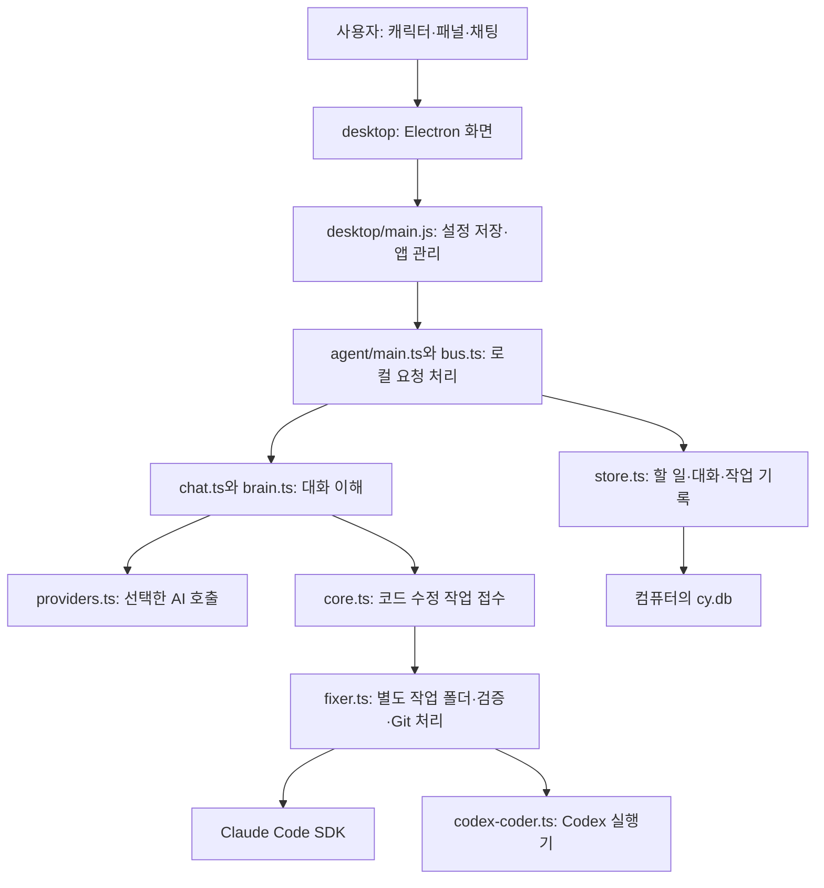

# 시사 비서 구조와 Codex 연결·코딩 문제 분석

2026-10-18, 현재 저장소와 설치된 macOS 앱을 직접 확인한 결과입니다.

## 1. 이 프로그램은 무엇인가

시사는 캐릭터가 떠 있는 데스크톱 비서입니다. 채팅 외에도 할 일, 일정, 브리핑, 프로젝트, 코드 수정 작업을 하나의 화면에서 다룹니다. 직접 AI 모델을 만드는 프로그램이 아니라, Claude Code·Codex 또는 여러 회사의 API를 불러 사용합니다.

프로그램은 크게 **보이는 앱(desktop)**과 **뒤에서 일하는 실행부(agent)**로 나뉩니다. 여기서 agent는 독립적인 외부 서버가 아니라, 설치된 앱이 사용자 컴퓨터에서 실행하는 Node.js 프로세스입니다. 두 부분은 로컬 주소 `127.0.0.1:47823`으로 통신합니다. 요청은 HTTP로 보내고, 작업 진행·응답 알림은 SSE로 받습니다.

데이터베이스와 설정은 로컬에 저장됩니다. 다만 AI가 답을 만들 때는 필요한 프롬프트·맥락이 해당 AI 서비스로 전송되고, 연동 서비스를 쓸 때도 네트워크 요청이 생깁니다. 따라서 ‘로컬 저장’과 ‘아무 데이터도 외부로 전송하지 않음’은 같은 뜻이 아닙니다.

## 2. 주요 폴더와 역할

| 위치 | 쉬운 설명 | 주요 파일 |
| --- | --- | --- |
| `desktop/` | 캐릭터·버튼·채팅창을 보여 주는 앱 | `main.js`, `renderer/panel.js`, `renderer/models-view.js` |
| `desktop/src/` | 로그인 확인·설정 저장·앱 시작을 돕는 로직 | `agent-login.js`, `sisa-store.js`, `bundle.js` |
| `agent/src/` | 채팅 처리와 실제 업무·코드 작업 | `main.ts`, `bus.ts`, `core.ts`, `chat.ts`, `brain.ts` |
| `agent/src/providers.ts` | API나 Codex CLI를 호출해 응답을 받는 연결부 | 기존 Codex 경로는 JSON 답변 전용 |
| `agent/src/fixer.ts` | 수정 작업 전체 순서를 관리하는 실행기 | 작업 폴더 생성, AI 호출, 테스트, 커밋·푸시·PR |
| `agent/src/codex-coder.ts` | 이번에 추가한 Codex 코딩 연결부 | 파일 수정·명령 실행·진행 기록·중단 처리 |
| `agent/src/store.ts`, `runs.ts` | 할 일·대화·실행 내역을 저장 | SQLite 사용 |
| `assets/`, `artwork/` | 캐릭터 그림·영상·대사 | AI 연결과는 별개 |
| `ops/`, `windows/` | 설치·실행·배포 지원 | 운영체제별 설정 |
| `docs/`, `*.test.ts`, `desktop/test/` | 설명과 자동 검사 | 테스트는 제품 기능 자체가 아님 |

앱 화면용 연결 설정은 macOS의 `~/Library/Application Support/cy-agent-desktop/sisa-ai.json`에 있습니다. 실제 실행 설정은 `~/.cy-agent/config.json`, 대화·할 일 등은 `~/.cy-agent/cy.db`에 있습니다. Codex 로그인은 별도로 Codex의 홈 폴더에서 관리됩니다. 이 세 종류의 상태가 자동으로 같은 의미가 되는 것은 아닙니다.

## 3. ‘로그인 확인됐는데 Claude만 보임’의 원인

당시 실제 상태는 다음과 같았습니다.

- Codex 로그인 확인 결과: 설치됨·로그인됨.
- 앱의 저장 상태: `provider: claudecode`, `clis: { claudecode: true }`.
- 실행부의 저장 상태: `brain.provider: claude-code`.

즉, **Codex 계정 인증은 정상인데 시사에서 사용할 AI로 연결·선택된 기록이 없었습니다.** 기존 모델 화면은 로그인 상태 전체가 아니라, 앱 설정의 `connectedProviders()` 목록만 보여 줬습니다. 그래서 사용자가 로그인 확인을 연결 완료로 이해하면 화면과 기대가 어긋났습니다.

여기에 별도 결함들이 겹쳐 있었습니다.

| 문제 지점 | 기존 동작 | 수정 |
| --- | --- | --- |
| `models-view.js` | 이미 저장된 연결만 선택 가능 | 로그인된 CLI를 확인해 ‘Codex 연결해서 사용’ 표시 |
| `llm-check.js` | Codex 모델을 ‘기본값’ 하나로 고정 | Codex의 모델 캐시에서 실제 표시 가능한 모델 목록 읽기 |
| `sisa-store.js`의 `daemonBrainPatch()` | Codex이면 선택 모델을 실행 설정에 전달하지 않음 | 선택값을 `brainModels.codex.general`에 전달, 기본값 초기화도 지원 |
| `agent-login.js`, `bundle.js` | Finder 실행 환경에서 ChatGPT 내장 Codex 경로를 놓칠 수 있음 | 로그인 검사와 실행부 양쪽에 해당 경로 탐색 추가 |
| 설치 앱 | 당시 `/chat/models` 요청에 `not found` 응답 | 최신 저장소와 수정 내용을 포함해 앱 재빌드·교체 |

경로 문제는 추가로 발견한 잠재적 실패 원인입니다. 당시 화면에서 Claude만 보인 직접적인 증거는 앱 연결 설정에 Codex가 없었다는 점입니다. 모든 원인이 같은 순간에 발생했다고 단정하지는 않습니다.

따라서 단순한 사용법 실수라고 보기 어렵습니다. 로그인 확인과 실제 사용 연결을 구분해 안내하지 못한 화면, 모델 전달 결함, 설치 버전 차이가 함께 있었습니다.

## 4. ‘Codex로 파일 수정·코딩이 안 됨’은 다른 문제

대화용 AI와 코드 수정 실행기는 원래 별도였습니다. 대화에서 Codex를 고르는 것은 `brain.provider`를 바꾸는 동작입니다. 그러나 기존 코딩 함수는 대화용 AI 선택과 무관하게 Claude SDK의 `query()`를 호출했습니다.

실제 제한은 여러 곳에 있었습니다.

1. `models-view.js`는 코딩 모델 목록을 Claude에서만 모았습니다.
2. `caps.js`와 `brain-state.js`는 코딩 가능 여부를 사실상 Claude 연결로 판단했습니다.
3. `fixer.ts`의 새 작업과 이어서 작업 모두 Claude SDK로 실행됐습니다.
4. `models.ts`는 코딩 역할을 Claude 모델로 해석했습니다.
5. 기존 `providers.ts`의 Codex는 읽기 전용 실행으로 JSON 답변만 받았고, 프롬프트에도 ‘도구를 부르지 말고 코드도 고치지 마라’는 지시가 있었습니다.

이것은 Codex가 파일을 못 고치는 문제가 아니라 **시사가 Codex의 코딩 기능을 연결하지 않은 구현상 제한**이었습니다. 대화 연결 문제를 고쳐도 이 제한은 그대로 남았기 때문에 두 차례 수정이 필요했습니다.

## 5. 이번 코딩 지원 변경

`coding.provider`와 `coding.model` 설정을 추가했습니다. 이제 대화 AI와 코딩 실행기를 따로 선택할 수 있습니다. 예를 들어 대화는 Claude, 코딩은 Codex로 설정해도 됩니다. 기존 설정에는 갑자기 다른 실행기가 적용되지 않도록 코딩 기본값을 Claude로 유지했습니다.

`fixer.ts`는 선택에 따라 Claude SDK 또는 새 `codex-coder.ts`를 사용합니다. Codex 쪽은 공식 `codex app-server` 프로토콜로 작업을 시작하고, 도구 실행과 결과를 기존 작업 세션 형식으로 변환합니다. 그래서 앱의 진행 내역·정지·추가 메시지·결과 처리 흐름을 재사용합니다.

수정 이후의 순서는 다음과 같습니다.

1. 채팅이 코드 수정 요청을 작업으로 접수합니다. Codex 채팅은 작은 수정도 이 경로로 보냅니다.
2. 등록된 Git 저장소인지 확인합니다.
3. 원격 기준 브랜치에서 별도 Git worktree와 작업 브랜치를 만듭니다. worktree는 원래 프로젝트 폴더를 그대로 둔 채 작업하는 별도 체크아웃입니다.
4. 선택한 실행기(Codex 또는 Claude)가 그 폴더의 파일을 고치고 테스트합니다.
5. 시사도 설정되거나 감지한 테스트를 돌립니다. 모든 프로젝트의 테스트를 자동으로 알아낼 수 있는 것은 아닙니다.
6. 검증 뒤 시사가 커밋·푸시하고, 가능하면 PR을 만듭니다. Codex에게 직접 커밋·푸시·머지를 맡기지 않습니다.
7. 결과와 진행 기록은 작업 세션에 남습니다. 기본 브랜치에 들어가는 것은 별도의 머지 절차입니다. 기존 자동 머지 설정이 있는 저장소는 그 설정을 따릅니다.

Codex는 별도 임시 홈을 사용해 기존 개인 MCP·플러그인 설정을 그대로 불러오지 않게 했습니다. 인증과 모델 캐시만 사용하며 인증 내용을 화면에 표시하지 않습니다. 읽기 전용 샌드박스에서 시작하고 파일 변경·권한 요청을 호스트가 검토합니다. 기존 커밋·푸시·머지 금지 훅을 연결했고, 파일 변경 경로는 실제 경로를 확인해 작업 폴더 밖 및 심링크 탈출을 차단합니다. 폴더 전체 권한과 지원하지 않는 승인 요청은 거부합니다.

## 6. 사용법과 범위

- 패널의 **모델 → 단순 채팅**에서 답변할 AI·모델을 선택합니다.
- **모델 → 파일 수정·코딩 작업**에서 실행기를 Codex로 선택하고 모델을 고릅니다.
- 코딩 실행기·모델 변경 후에는 앱을 다시 켭니다. 대화 AI 변경과 달리 이 설정은 시작할 때 읽습니다.
- 설정에 프로젝트 폴더가 등록되어 있어야 합니다. ‘프로젝트’의 업무 목록과 실제 Git 저장소는 서로 다릅니다.
- 채팅에는 대상 프로젝트와 원하는 변경을 구체적으로 적습니다. 예: ‘/내/프로젝트에서 로그인 버튼 문구를 시작하기로 바꾸고 테스트해 줘.’
- 작업 세션에서 진행과 실패 이유를 확인합니다. Git 원격 `origin`, 기준 브랜치, 원격 쓰기 권한이 필요하며 GitHub PR에는 `gh` 로그인도 필요합니다.

이번에 추가한 것은 **등록된 Git 프로젝트의 파일 수정·코딩 실행**입니다. 컴퓨터의 아무 파일이나 원본 위치에서 바로 덮어쓰는 기능을 뜻하지 않습니다. Codex 채팅의 직접 MCP 조작, Claude 전용 백그라운드 Agent 도구, Claude CLI 세션을 그대로 이어 여는 기능까지 Codex로 바꾼 것은 아닙니다. 끝난 Codex 작업의 ‘이어서 하기’는 기존 작업 요약을 넣어 새 Codex 실행으로 이어집니다.

## 7. 검증 근거

- 실제 Codex 채팅: `gpt-6.1-sol`이 ‘Codex 연결이 정상입니다’라고 응답했고, 저장 기록의 공급자·모델도 일치했습니다. 앱 재시작 후 설정 유지도 확인했습니다.
- 실제 Codex 파일 수정: 임시 폴더에 파일을 만들고 바이트 단위로 내용을 다시 읽어 확인했습니다.
- 실제 코딩 파이프라인: 별도 테스트 저장소와 로컬 bare 원격을 만들고, Codex가 `value.txt`를 `before`에서 `after`로 변경했습니다. 검증 명령이 통과한 뒤 시사가 작업 브랜치를 커밋·푸시했으며 원래 체크아웃은 `before`로 유지됐습니다. 작업 기록은 `done`과 선택 모델로 남았습니다.
- 위 파이프라인 검증은 외부 GitHub에 시험 PR을 만들지 않았습니다. GitHub 게시 동작 전체를 실계정으로 검증했다고 주장하지 않습니다.
- 최신 원본 코드에 수정안을 적용한 뒤 타입 검사 통과. 실행부 980개 통과·8개 제외, 데스크톱 645개 통과·1개 제외, 실패 0개. 실행기 선택, 경로 이탈·배포 명령 차단, 프로토콜 결과 전달·정지와 기존 기능을 검사했습니다. 실행부 테스트에서는 사용자 컴퓨터의 전역 Git 이름이 기본 이름 테스트에 섞이지 않도록 `GIT_CONFIG_GLOBAL=/dev/null`을 적용했습니다.

공식 프로토콜 근거: [OpenAI Codex App Server 문서](https://learn.chatgpt.com/docs/app-server).
